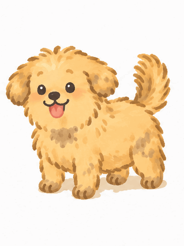

# 누렁이 (Nureongi)

<p align="center">
  
</p>

바탕화면 아래를 돌아다니면서 말풍선으로 다정하게 잔소리하는 시골 강아지입니다.

**이 누렁이는 귀여움이 무기입니다.** 혼내지도 않고 비꼬지도 않습니다. 꼬리를 흔들며 "허리 한번 쭉 펴요, 멍!" 하고 말할 뿐인데, 그 얼굴을 보면 안 펼 수가 없습니다.

## 누렁이가 하는 일

### 평소
- 화면 맨 아래를 좌우로 달리다가 멈춰서 꼬리를 흔듭니다.
- 마우스로 끌면 놀란 얼굴로 따라오고, 놓으면 바닥으로 떨어집니다.
- 누렁이가 아닌 곳은 클릭이 그대로 뒤 화면으로 통과합니다.

### 먼저 말 걸기

| 언제 | 하는 말 |
|---|---|
| 켰을 때 | 인사와 함께 오늘 할 일을 알려 줍니다 |
| 오전 매 정각 | 지금 몇 시인지 알려 줍니다 |
| 11:19 | 점심 먹으라고 합니다 |
| 30분마다 | 허리 펴기, 영양제, 잠깐 쉬기, 스트레칭, 물 마시기, 눈 쉬기 중 하나를 골라 말합니다 |
| 16:59 | 오늘 일한 시간, 쉰 횟수, 끝낸 일을 정리해 주고 퇴근하자고 합니다 |

자리를 5분 넘게 비우면 말을 걸지 않습니다.

### 대화
누렁이를 **한 번 클릭**하면 입력창이 열립니다. Enter로 보내고 Esc로 닫습니다.

- "오늘 할 일은 보고서 쓰기랑 메일 답장하기야" → 할 일을 기억합니다.
- "내일 할 일은 주간보고 발송이야" → 내일 날짜로 기억해 두고, 내일 켰을 때 알려 줍니다.
- "보고서 다 썼어" → 목록에서 빼고 오늘 끝낸 일로 기록합니다.
- "오늘 코스피 어때?" → 웹을 검색해서 핵심만 알려 줍니다.
- "30분마다 말 걸어 줘" → 먼저 말 거는 간격을 바꿉니다.

### 놀아 주기
누렁이를 **더블클릭**하면 메뉴가 뜹니다.

| 메뉴 | 누렁이가 하는 것 |
|---|---|
| 🍚 밥 주기 | 밥그릇에 코를 박고 먹습니다 |
| 🤚 쓰다듬기 | 눈을 감고 좋아합니다 |
| 🐶 앉아 | 앉아서 헥헥거립니다 |
| 🐾 손 | 앞발을 듭니다 |
| ⭐ 점프 | 화면 천장까지 뛰어오릅니다 |
| 🏃 따라와 | 7초 동안 마우스를 쫓아옵니다. 마우스를 위로 올리면 그 높이까지 뛰어오릅니다 |
| 🎾 공 던지기 | 공이 날아가 바닥에서 튀면, 달려가서 물고 돌아와 내려놓습니다 |

**오른쪽 클릭**하면 할 일 보기, 하루 마무리 듣기, 알림 미리 보기, 설정, 종료 메뉴가 나옵니다.

## 실행하기

macOS에서 만들고 확인했습니다. [Node.js](https://nodejs.org)가 필요합니다.

```bash
git clone https://github.com/suminzz/nureongi.git
cd nureongi
npm install
npm start
```

### API 키 (선택)
누렁이가 상황에 맞게 말하고 대화하려면 Claude API 키가 필요합니다. 키가 없어도 누렁이는 돌아다니고, 미리 준비된 말로 알림을 합니다. 대화와 검색만 되지 않습니다.

```bash
cp .env.example .env
```

`.env` 파일을 열어 `ANTHROPIC_API_KEY=` 뒤에 키를 붙여 넣습니다. 키는 [console.anthropic.com](https://console.anthropic.com)에서 발급받습니다. `.env`는 저장소에 올라가지 않습니다.

API를 쓰면 누렁이가 말할 때마다 요금이 조금씩 나갑니다. 가만히 돌아다니는 동안에는 나가지 않습니다.

## 설정

오른쪽 클릭 → "설정 파일 열기"로 엽니다. 파일 위치는 `~/Library/Application Support/desktop-puppy/settings.json`입니다.

```json
{
  "name": "누렁이",
  "goals": [
    { "text": "보고서 쓰기", "date": "2026-11-12" },
    { "text": "물 자주 마시기", "date": "" }
  ],
  "nagMinutes": 30,
  "reminders": {
    "lunch": "11:19",
    "leave": "16:59",
    "hourlyMorning": true,
    "careMinutes": 30
  }
}
```

| 항목 | 뜻 |
|---|---|
| `name` | 강아지 이름 |
| `goals` | 할 일 목록. 대화로 등록해도 여기에 저장됩니다. `date`는 할 날짜이고, 비워 두면 날짜와 상관없는 매일 목표입니다 |
| `nagMinutes` | 알림이 없을 때 먼저 말 거는 간격(분). 0이면 끔 |
| `reminders.lunch`, `reminders.leave` | 점심·퇴근 알림 시각. 빈 문자열이면 끔 |
| `reminders.hourlyMorning` | 오전 정각 알림 |
| `reminders.careMinutes` | 챙김 알림 간격(분). 0이면 끔 |

## 폴더 구성

| 파일 | 역할 |
|---|---|
| `main.js` | 투명한 창을 띄우고 누렁이를 움직입니다. 알림 시각 확인, 메뉴, 놀아 주기 동작 |
| `ball.html`, `ball.js` | 공 던지기에 쓰는 공 그림 |
| `renderer.js`, `index.html` | 그림, 말풍선, 클릭과 드래그 처리 |
| `brain.js` | 성격, 대화, 알림 문구, 할 일 저장, 웹 검색 |
| `reminders.js` | 지금 어떤 알림을 할 때인지 판단 |
| `day.js` | 오늘 일한 시간, 쉰 횟수, 끝낸 일 기록 |
| `art/` | 캐릭터 원본 그림과 GIF |
| `sprites/` | 원본에서 배경을 지우고 잘라 낸 동작별 그림 |
| `tools/` | 원본 그림을 잘라 `sprites/`를 만드는 Python 도구 |

### 그림 바꾸기
`art/`의 그림을 바꾼 뒤 아래 명령으로 `sprites/`를 다시 만듭니다. Python 3와 Pillow, NumPy, SciPy가 필요합니다.

```bash
python3 tools/cut_sprites.py
```
